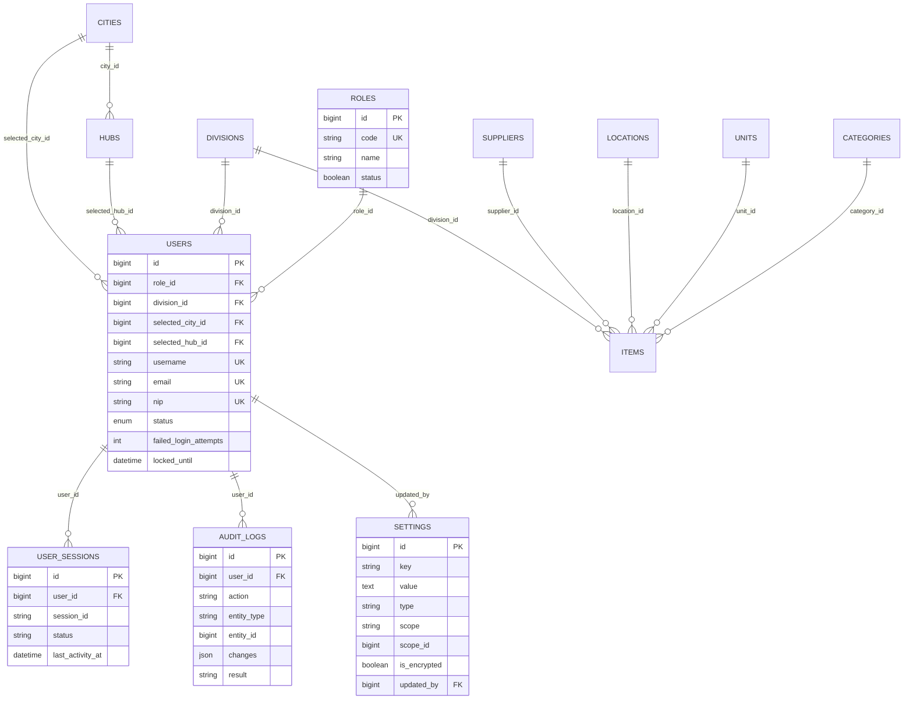
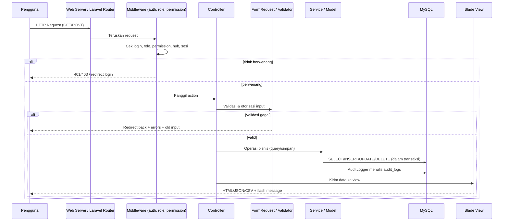

# Laporan Implementasi Backend — ERP Inventory

Dokumen ini merupakan dokumentasi hasil akhir implementasi backend untuk modul **Dashboard (5 role)**, **Manajemen Pengguna (Super Admin)**, dan **Pengaturan (semua role)** pada proyek `ERP-Inventory`, sesuai `backend_prompt.md`.

- Tanggal implementasi: 18 November 2026
- Stack: Laravel 11 + MySQL (XAMPP), Blade + Tailwind (CDN), PHPUnit
- Basis data pengembangan: `laravel`
- Basis data pengujian: `laravel_test` (terpisah, agar test tidak menghapus data pengembangan)

---

## 1. Ringkasan Kondisi Awal Proyek

| Aspek | Kondisi awal | Dampak |
|---|---|---|
| Dashboard | Satu file `dashboard/index.blade.php` (~1.900 baris) berisi angka, nama, dan aktivitas statis untuk 5 role | Angka tidak berasal dari database; tidak ada controller dashboard |
| Manajemen Pengguna | View `manajemenPengguna.blade.php` berisi tabel & modal statis dengan toast sukses palsu | CRUD tidak tersimpan; filter/pencarian tidak berfungsi |
| Pengaturan | `pengaturan.blade.php` ~3.400 baris duplikat antar role, seluruh form statis | Tidak ada tabel/endpoint penyimpanan konfigurasi |
| Route | Dashboard berupa closure; route Kepala Gudang masih memakai prefix/name `gudang.*` | Melanggar ketentuan prefix `kepalagudang` |
| Role | 5 role: `super_admin`, `kepala_gudang`, `hr`, `pegawai`, `audit` | Konsisten, dipertahankan |
| Tabel domain | Hanya master data + `users`, `user_sessions`, `audit_logs` | Tidak ada tabel transaksi, stok, opname, persetujuan, temuan audit |
| Pengujian | Test lama terbatas pada master data, sesi, dan profil | Belum ada test untuk dashboard/user/pengaturan |

**Keputusan penting:** modul yang tidak memiliki tabel pendukung (transaksi, stok per SKU, opname, approval, temuan audit, scanner, 2FA, backup, SAP, webhook) **tidak disimulasikan**. UI menampilkan status “belum tersedia” secara eksplisit dan tombolnya dinonaktifkan.

---

## 2. Daftar File yang Diperiksa (Audit)

**Routing & middleware**
- `routes/web.php`
- `app/Http/Kernel.php`
- `app/Http/Middleware/CheckRole.php`, `CheckPermission.php`, `EnsureHubSelected.php`, `CheckRevokedSession.php`

**Model**
- `app/Models/User.php`, `Role.php`, `Permission.php`, `Hub.php`, `City.php`, `Division.php`, `Category.php`, `Unit.php`, `Location.php`, `Supplier.php`, `Item.php`, `UserSession.php`, `AuditLog.php`, `Setting.php`

**Controller & request**
- `Auth/LoginController.php`, `HubSelectionController.php`, `ProfileController.php`, `ProfilePageController.php`, `SessionController.php`, `NotifikasiController.php`
- `DashboardController.php`, `UserManagementController.php`, `PengaturanController.php`
- `StoreUserRequest.php`, `UpdateUserRequest.php`

**Migration & seeder**
- Seluruh migration pada `database/migrations/`
- `DatabaseSeeder`, `RolesAndUsersSeeder`, `HubSeeder`, `CitiesAndHubsSeeder`, `MasterDataSeeder`

**View**
- `resources/views/dashboard/index.blade.php`
- `resources/views/dashboard/pengaturan.blade.php`
- `resources/views/dashboard/superadmin/manajemenPengguna.blade.php`
- `resources/views/components/sidebar.blade.php`, `navbar.blade.php`

**Pengujian**
- `phpunit.xml`, `tests/Feature/*`, `tests/Unit/*`

---

## 3. Daftar File yang Dibuat / Diubah

### 3.1 Dibuat

| File | Fungsi |
|---|---|
| `app/Http/Controllers/DashboardController.php` | Menyediakan metrik dashboard nyata untuk semua role |
| `app/Http/Controllers/UserManagementController.php` | CRUD, filter, sort, paginasi, bulk action, CSV export, riwayat aktivitas |
| `app/Http/Requests/StoreUserRequest.php` | Validasi server-side pembuatan pengguna |
| `app/Http/Requests/UpdateUserRequest.php` | Validasi server-side pembaruan pengguna |
| `app/Models/Setting.php` | Model konfigurasi key/value + dekripsi nilai rahasia |
| `app/Models/AuditLog.php` | Model jejak audit |
| `app/Support/SettingCatalog.php` | Katalog konfigurasi: grup, tipe, scope, validasi, hak edit per role, status dukungan |
| `app/Support/SettingService.php` | Baca/simpan/reset konfigurasi, enkripsi secret, audit perubahan |
| `app/Support/AuditLogger.php` | Penulis jejak audit terpusat |
| `database/migrations/2026_11_18_000001_create_settings_table.php` | Tabel `settings` |
| `database/migrations/2026_11_18_000002_add_division_id_to_users_table.php` | Kolom `division_id` pada `users` |
| `tests/Feature/BackendImplementationTest.php` | 18 test backend (dashboard + scoping hub, RBAC, CRUD, settings, route prefix) |
| `LAPORAN_IMPLEMENTASI_BACKEND.md` | Dokumen ini |

### 3.2 Diubah

| File | Perubahan |
|---|---|
| `routes/web.php` | Dashboard via controller; route pengaturan 4 endpoint per role; route manajemen pengguna; rename `gudang.*` → `kepalagudang.*` |
| `app/Http/Controllers/PengaturanController.php` | Ditulis ulang: index/update/reset/history berbasis katalog & izin role |
| `app/Models/User.php` | Relasi `division`, `sessions`, `auditLogs`; lockout memakai `security.max_login_attempts` & `security.lockout_minutes` |
| `app/Providers/AppServiceProvider.php` | Menerapkan `security.session_timeout_minutes` ke `config('session.lifetime')` |
| `app/Http/Controllers/Auth/LoginController.php` | Redirect kepala gudang ke `kepalagudang.dashboard`; pencatatan `user_sessions` |
| `app/Http/Controllers/HubSelectionController.php` | Redirect kepala gudang & pegawai setelah pemilihan hub |
| `resources/views/dashboard/index.blade.php` | Angka, chart, feed aktivitas, dan status perangkat memakai data DB; empty state jujur; tombol tak tersedia dinonaktifkan |
| `resources/views/dashboard/superadmin/manajemenPengguna.blade.php` | Statistik, filter, tabel, paginasi, modal tambah/ubah, riwayat, bulk action nyata; hapus toast palsu |
| `resources/views/dashboard/pengaturan.blade.php` | Ditulis ulang menjadi form data-driven per role (tab, switch, secret masking, reset, log perubahan) |
| `resources/views/components/sidebar.blade.php` | Semua tautan Kepala Gudang → `kepalagudang.*` |
| `phpunit.xml` | `DB_DATABASE=laravel_test` agar test tidak menyentuh DB pengembangan |
| `database/seeders/DatabaseSeeder.php` | Urutan seeding: `HubSeeder` dulu, baru `RolesAndUsersSeeder`, agar penugasan hub akun demo valid |
| `database/seeders/RolesAndUsersSeeder.php` | Menetapkan `selected_hub_id`/`selected_city_id` untuk 6 akun demo sesuai hub distribusinya |
| *(dihapus)* `tests/Feature/ZzTempSidebarCompareTest.php` | Test sementara yang memaksa SQLite dan menghapus seluruh tabel DB pengembangan |

---

## 4. Arsitektur Backend per Modul

### 4.1 Dashboard

- Satu controller (`DashboardController@index`) dipakai oleh 5 route role. Middleware `role:*` menjaga akses.
- Data yang dihitung langsung dari tabel: total/aktif/nonaktif pengguna, pengguna baru bulan ini, pengguna per role, SKU, kategori, supplier, divisi, hub, kota, sesi aktif 30 menit, total & 8 log audit terbaru, 6 pengguna terbaru, 6 item terbaru, 6 hub menurut okupansi, dan 6 kategori dengan jumlah item.
- **Metrik pengguna dibatasi per hub distribusi** (`users.selected_hub_id = user.selectedHub`), bukan seluruh sistem. Yang ikut ter-scope: `totalUsers`, `activeUsers`, `inactiveUsers`, `newUsersThisMonth`, `usersByRole[].users_count`, `activeSessions`, `recentUsers`, serta angka "Akun" pada panel Pengguna Terbaru. Antar hub tidak dicampur; nilai tiap hub tetap dapat dijumlahkan menjadi total sistem.
- Bila akun belum ditugaskan ke hub (`selected_hub_id` null), metrik jatuh ke cakupan seluruh hub dan UI menampilkan label **"Semua hub"** secara eksplisit (`hubScoped=false`).
- `unavailableModules()` mengirim daftar modul tanpa tabel pendukung; view menampilkannya sebagai banner peringatan.
- Semua role memakai variabel yang sama; tampilan per role tetap dipertahankan (header, KPI, grid) namun nilainya dinamis dan berlabel kode hub (`HUB-JKT-01`, dst.).
- Tombol/tindakan yang tidak punya endpoint nyata (scanner, unduh laporan ringkas, sample test, ekspor audit) ditandai **nonaktif** dengan `title` alasan.

### 4.2 Manajemen Pengguna (Super Admin)

- Hanya bisa diakses `role:super_admin` **dan** `permission:user.manage` (double layer di route + `authorizeManage()` di controller dan `authorize()` di FormRequest).
- **Index**: pencarian `q` (nama, username, email, NIP), filter `role`, `status`, `hub`, `division`, sort (`nama_lengkap`, `username`, `email`, `nip`, `status`, `last_login_at`, `created_at`), arah `asc|desc`, paginasi `per_page` (10/25/50).
- **Store**: validasi unik username/email/NIP, password minimal 8 + konfirmasi, role harus aktif, divisi/hub harus ada; berjalan dalam `DB::transaction`, menulis audit `create` dengan snapshot.
- **Update**: validasi unik dengan `ignore`, password opsional (kosong = tidak diubah). Super Admin terakhir tidak boleh diturunkan perannya; audit `update` menyimpan before/after (tanpa password).
- **Toggle status**: tidak boleh menonaktifkan diri sendiri; Super Admin aktif terakhir tidak boleh dinonaktifkan; audit `activate`/`deactivate`.
- **Destroy**: soft delete, tidak boleh menghapus diri sendiri/Super Admin terakhir, seluruh sesi aktif dicabut, audit `delete`.
- **Bulk**: aksi `activate|deactivate|delete`; akun sendiri & Super Admin terakhir dilewati dan dilaporkan pada pesan flash.
- **Export CSV**: mengikuti filter aktif; kolom tanpa password/token; setiap ekspor diaudit.
- **Activity JSON**: 25 log audit + 10 sesi perangkat untuk modal riwayat; data di-escape di sisi klien.

### 4.3 Pengaturan (semua role)

- Tabel `settings` key/value dengan `scope`:
  - `global` (`scope_id = 0`) – nama sistem, timezone, integrasi ERP, keamanan
  - `hub` (`scope_id = hubs.id`) – profil hub, aturan stok, printer
  - `user` (`scope_id = users.id`) – preferensi bahasa/notifikasi/tampilan
- `SettingCatalog` adalah sumber kebenaran: grup, label, tipe, default, opsi, validasi, role yang boleh edit, dan `supported=false` untuk fitur yang tidak dapat diterapkan.
- `SettingService`:
  - membaca nilai efektif (stored → fallback kolom hub → default)
  - menyimpan hanya field yang boleh diedit role; field asing → error validasi; field terlarang → 403
  - secret dienkripsi AES-256 (`Crypt::encryptString`) dan selalu dikembalikan sebagai `••••••••`; secret kosong berarti tidak diubah
  - scope hub wajib memiliki hub terpilih
  - menulis audit `Setting` berisi daftar perubahan (secret dimasker)
- `reset` menghapus override yang boleh diedit role dan mengembalikan default; `history` mengembalikan 50 log terbaru (Super Admin: semua; role lain: miliknya sendiri).
- Hak edit: Super Admin (global+hub+user), Kepala Gudang (hub+user), HR/Pegawai/Auditor (user saja).

---

## 5. Diagram Alur Dashboard

```mermaid
flowchart TD
    A[Request GET /{role}/dashboard] --> B{Middleware auth + role}
    B -- gagal --> Z[401/403]
    B -- lolos --> C[DashboardController@index]
    C --> D[Ambil user + selectedHub]
    D --> E{selected_hub_id ada?}
    E -- ya --> E1[Metrik pengguna: WHERE selected_hub_id = hub]
    E -- tidak --> E2[Metrik pengguna: seluruh hub + label "Semua hub"]
    E1 --> F[Query item/kategori/supplier/divisi/hub/kota]
    E2 --> F
    F --> G[Query audit_logs terbaru + total]
    G --> H[Query 6 item/pengguna/hub/kategori terbaru]
    H --> I[Hitung unavailableModules sesuai role]
    I --> J[Render dashboard.index]
    J --> K[Angka & feed dari DB + kode hub]
    J --> L[Banner modul belum tersedia]
    J --> M[Tombol tanpa endpoint: disabled]
```

---

## 6. Diagram Alur Manajemen Pengguna

```mermaid
flowchart TD
    A[Super Admin] --> B[GET /admin/pengguna]
    B --> C{role:super_admin + permission:user.manage}
    C -- gagal --> Z[403]
    C -- lolos --> D[UserManagementController@index]
    D --> E[Validasi filter q/role/status/hub/division/sort/dir/per_page]
    E --> F[Query + paginate + withQueryString]
    F --> G[Render tabel + statistik + pill role]

    G --> H[Tambah/Edit via modal]
    H --> I{POST store / PUT update}
    I --> J[FormRequest authorize + validasi]
    J -- gagal --> K[Redirect back + errors + old input]
    J -- lolos --> L[DB::transaction]
    L --> M[Simpan user]
    M --> N[AuditLogger create/update]
    N --> O[Redirect + flash sukses]

    G --> P[Toggle status / Hapus / Bulk]
    P --> Q[Cek akun sendiri & Super Admin terakhir]
    Q -- ditolak --> R[Flash error]
    Q -- lolos --> S[DB::transaction + audit]
    S --> O

    G --> T[Export CSV] --> U[StreamedResponse tanpa kredensial + audit]
    G --> V[Riwayat aktivitas] --> W[JSON audit_logs + user_sessions]
```

---

## 7. Diagram Alur Pengaturan

```mermaid
flowchart TD
    A[GET /{role}/pengaturan] --> B[PengaturanController@index]
    B --> C[SettingService@valuesFor]
    C --> D[Global + hub terpilih + user]
    D --> E[SettingCatalog: can_edit per role, supported]
    E --> F[Render tab & field; secret dimasker]

    F --> G[Submit POST /{role}/pengaturan]
    G --> H[Validasi array settings]
    H --> I[SettingService@save]
    I --> J{Field dikenal?}
    J -- tidak --> K[ValidationException]
    J -- ya --> L{Boleh diedit role?}
    L -- tidak --> M[403 AccessDenied]
    L -- ya --> N{Scope hub?}
    N -- ya & tanpa hub --> O[Error: pilih hub]
    N -- tidak --> P[Normalisasi + validasi nilai]
    P --> Q[updateOrCreate settings + enkripsi secret]
    Q --> R[Kumpulkan changes]
    R --> S[AuditLogger Setting update]
    S --> T[Redirect + flash jumlah perubahan]

    F --> U[Reset] --> V[Hapus override yang boleh diedit] --> S
    F --> W[Log perubahan] --> X[AuditLog entity_type=Setting]
```

---

## 8. Tabel Route per Role

### 8.1 Dashboard

| Method | URL | Route name | Controller/action | Middleware | Fungsi |
|---|---|---|---|---|---|
| GET | `/admin/dashboard` | `admin.dashboard` | `DashboardController@index` | `web, auth, role:super_admin` | Dashboard Super Admin |
| GET | `/kepalagudang/dashboard` | `kepalagudang.dashboard` | `DashboardController@index` | `web, auth, role:kepala_gudang` | Dashboard Kepala Gudang |
| GET | `/hr/dashboard` | `hr.dashboard` | `DashboardController@index` | `web, auth, role:hr` | Dashboard HR |
| GET | `/pegawai/dashboard` | `pegawai.dashboard` | `DashboardController@index` | `web, auth, role:pegawai` | Dashboard Pegawai |
| GET | `/audit/dashboard` | `audit.dashboard` | `DashboardController@index` | `web, auth, role:audit` | Dashboard Auditor |

### 8.2 Manajemen Pengguna (Super Admin)

| Method | URL | Route name | Controller/action | Middleware | Fungsi |
|---|---|---|---|---|---|
| GET | `/admin/pengguna` | `admin.pengguna` | `UserManagementController@index` | `web, auth, role:super_admin, permission:user.manage` | Daftar + filter + paginasi |
| POST | `/admin/pengguna` | `admin.pengguna.store` | `UserManagementController@store` | idem | Buat pengguna |
| PUT | `/admin/pengguna/{user}` | `admin.pengguna.update` | `UserManagementController@update` | idem | Ubah pengguna |
| POST | `/admin/pengguna/{user}/toggle-status` | `admin.pengguna.toggle-status` | `UserManagementController@toggleStatus` | idem | Aktif/nonaktif |
| DELETE | `/admin/pengguna/{user}` | `admin.pengguna.destroy` | `UserManagementController@destroy` | idem | Soft delete + cabut sesi |
| POST | `/admin/pengguna/bulk` | `admin.pengguna.bulk` | `UserManagementController@bulk` | idem | Aksi massal |
| GET | `/admin/pengguna/export` | `admin.pengguna.export` | `UserManagementController@export` | idem | CSV tanpa kredensial |
| GET | `/admin/pengguna/{user}/activity` | `admin.pengguna.activity` | `UserManagementController@activity` | idem | JSON audit + sesi |

### 8.3 Pengaturan (4 endpoint per role)

| Role | Method | URL | Route name | Middleware | Fungsi |
|---|---|---|---|---|---|
| Super Admin | GET | `/admin/pengaturan` | `admin.pengaturan` | `auth, role:super_admin` | Form konfigurasi |
| Super Admin | POST | `/admin/pengaturan` | `admin.pengaturan.update` | idem | Simpan |
| Super Admin | POST | `/admin/pengaturan/reset` | `admin.pengaturan.reset` | idem | Reset ke default |
| Super Admin | GET | `/admin/pengaturan/history` | `admin.pengaturan.history` | idem | JSON log perubahan |
| Kepala Gudang | GET | `/kepalagudang/pengaturan` | `kepalagudang.pengaturan` | `auth, role:kepala_gudang` | Form konfigurasi hub + preferensi |
| Kepala Gudang | POST | `/kepalagudang/pengaturan` | `kepalagudang.pengaturan.update` | idem | Simpan |
| Kepala Gudang | POST | `/kepalagudang/pengaturan/reset` | `kepalagudang.pengaturan.reset` | idem | Reset |
| Kepala Gudang | GET | `/kepalagudang/pengaturan/history` | `kepalagudang.pengaturan.history` | idem | Log |
| HR | GET/POST | `/hr/pengaturan` | `hr.pengaturan` / `hr.pengaturan.update` | `auth, role:hr` | Preferensi pengguna |
| HR | POST/GET | `/hr/pengaturan/reset` / `history` | `hr.pengaturan.reset` / `.history` | idem | Reset / log |
| Pegawai | GET/POST | `/pegawai/pengaturan` | `pegawai.pengaturan` / `.update` | `auth, role:pegawai` | Preferensi pengguna |
| Pegawai | POST/GET | `/pegawai/pengaturan/reset` / `history` | `pegawai.pengaturan.reset` / `.history` | idem | Reset / log |
| Auditor | GET/POST | `/audit/pengaturan` | `audit.pengaturan` / `.update` | `auth, role:audit` | Preferensi pengguna |
| Auditor | POST/GET | `/audit/pengaturan/reset` / `history` | `audit.pengaturan.reset` / `.history` | idem | Reset / log |

> Catatan: seluruh route Kepala Gudang memakai prefix `/kepalagudang` dan name `kepalagudang.*`; identifier role di database tetap `kepala_gudang`. Test `kepala gudang routes use required prefix and names` memverifikasi `gudang.dashboard` tidak ada.

---

## 9. Matriks Role–Permission

### 9.1 Permission inti (dari `RolesAndUsersSeeder`)

| Permission | Super Admin | Kepala Gudang | HR | Pegawai | Auditor |
|---|:---:|:---:|:---:|:---:|:---:|
| `dashboard.view` | ✅ | ✅ | ✅ | ✅ | ✅ |
| `master.view` | ✅ | ✅ | ✅ | ✅ | ✅ |
| `master.manage` | ✅ | ✅ | – | – | – |
| `product.manage` | ✅ | ✅ | – | – | – |
| `master.delete` | ✅ | ✅ | – | – | – |
| `product.label` | ✅ | ✅ | – | ✅ | – |
| `transaction.view` | ✅ | ✅ | ✅ | ✅ | ✅ |
| `receipt.create` | – | ✅ | – | ✅ | – |
| `receipt.void` | – | ✅ | – | – | – |
| `issue.create` | – | ✅ | ✅ | ✅ | – |
| `issue.approve` | – | – | ✅ | – | – |
| `adjustment.approve` | – | – | ✅ | – | – |
| `opname.approve` | – | – | ✅ | – | – |
| `opname.count` | – | ✅ | – | ✅ | – |
| `opname.manage` | – | ✅ | – | – | – |
| `report.view` | ✅ | ✅ | ✅ | ✅ | ✅ |
| `report.export` | ✅ | ✅ | ✅ | – | ✅ |
| `user.view` / `user.manage` | ✅ | – | – | – | – |
| `role.manage` | ✅ | – | – | – | – |
| `audit.view` | ✅ | – | – | – | ✅ |
| `settings.view` | ✅ | ✅ | – | – | – |
| `settings.manage` | ✅ | – | – | – | – |
| `system.errors`, `backup.*` | ✅ | – | – | – | – |

### 9.2 Hak halaman yang diimplementasikan

| Modul | Super Admin | Kepala Gudang | HR | Pegawai | Auditor |
|---|:---:|:---:|:---:|:---:|:---:|
| Dashboard | ✅ | ✅ | ✅ | ✅ | ✅ |
| Manajemen Pengguna | ✅ (penuh) | ❌ 403 | ❌ 403 | ❌ 403 | ❌ 403 |
| Pengaturan – lihat | ✅ | ✅ | ✅ | ✅ | ✅ |
| Pengaturan – edit preferensi user | ✅ | ✅ | ✅ | ✅ | ✅ |
| Pengaturan – edit hub/stok/printer | ✅ | ✅ | ❌ 403 | ❌ 403 | ❌ 403 |
| Pengaturan – edit global/ERP/keamanan | ✅ | ❌ 403 | ❌ 403 | ❌ 403 | ❌ 403 |
| Reset konfigurasi | ✅ (semua editable) | ✅ (hub+user) | ✅ (user) | ✅ (user) | ✅ (user) |
| Riwayat perubahan | Semua log | Log miliknya | Log miliknya | Log miliknya | Log miliknya |

---

## 10. Hubungan Model dan Tabel Database



**Aturan penting**
- `settings` memiliki unique `(scope, scope_id, key)` sehingga nilai global/hub/user tidak saling menimpa.
- `settings.value` untuk tipe `secret` disimpan terenkripsi dan `is_encrypted = true`.
- `users` memakai soft delete; `user_sessions` dan `audit_logs` tetap menyimpan riwayat.
- `users.status` hanya `active|inactive` (sesuai enum yang ada).

---

## 11. Validasi dan Keamanan

| Area | Mekanisme |
|---|---|
| Autentikasi | Session guard Laravel; login mencatat `user_sessions` (IP, user agent, perangkat) |
| Otorisasi route | `role:*` + `permission:*` (CheckRole/CheckPermission) |
| Otorisasi controller | `authorizeManage()` dan `FormRequest::authorize()` untuk pengguna; `SettingCatalog` untuk pengaturan |
| Validasi input | FormRequest (user) dan `Validator` (settings); whitelist key konfigurasi |
| Mass assignment | `$fillable` eksplisit pada model |
| Transaksi | `DB::transaction` pada create/update/delete/bulk user dan penyimpanan/reset settings |
| Secret | `Crypt::encryptString`, dikembalikan sebagai `••••••••`, tidak pernah masuk audit mentah |
| XSS | Semua data JSON riwayat di-escape sebelum `innerHTML` (`esc()`) |
| CSRF | `@csrf` pada seluruh form POST/PUT/DELETE |
| Proteksi akun | Tidak bisa menonaktifkan/menghapus diri sendiri; Super Admin aktif terakhir dilindungi |
| Lockout login | `security.max_login_attempts` + `security.lockout_minutes` dibaca dari tabel settings |
| Timeout sesi | `security.session_timeout_minutes` diterapkan ke `config('session.lifetime')` |
| Audit | `AuditLogger` untuk create/update/activate/deactivate/delete/bulk/export/settings |
| Data sensitif | Export CSV tidak memuat password/token; respons JSON hanya field yang diperlukan |

---

## 12. Fitur yang Berhasil Diimplementasikan

1. Dashboard nyata untuk 5 role (angka, chart komposisi kategori, item terbaru, pengguna terbaru, log audit).
2. Metrik pengguna (total/aktif/nonaktif/baru/per-role/sesi/daftar pengguna terbaru) dibatasi per hub distribusi terpilih, tidak mencampur seluruh sistem; label kode hub tampil di kartu, dan fallback "Semua hub" bila akun belum ditugaskan.
3. Banner eksplisit modul yang belum tersedia (transaksi, approval, opname, temuan audit, stok per SKU, throughput, tugas pegawai).
4. Manajemen pengguna lengkap: list, cari, filter role/status/hub/divisi, sort, paginasi, tambah, ubah, aktif/nonaktif, hapus, bulk, ekspor CSV, riwayat aktivitas.
5. Proteksi Super Admin terakhir & akun sendiri.
6. Pengaturan data-driven untuk semua role dengan tab, switch, select, secret masking, validasi, reset, dan log perubahan.
7. Audit trail untuk seluruh aksi sensitif.
8. Rename route Kepala Gudang ke `kepalagudang.*` + `/kepalagudang`.
9. Penambahan `division_id` pada `users` untuk filter/penugasan divisi.
10. Konfigurasi keamanan benar-benar memengaruhi lockout login dan lifetime sesi.
11. Test otomatis backend (18 skenario baru) dan isolasi DB pengujian.

---

## 13. Fitur yang Belum Dapat Diimplementasikan (Keterbatasan Source/Infrastruktur)

| Fitur | Alasan | Perlakuan di UI |
|---|---|---|
| Barang masuk/keluar & mutasi | Tidak ada tabel transaksi, stok, atau detail dokumen | Angka `—`, banner “belum tersedia”, tombol nonaktif |
| Persetujuan (approval) | Tidak ada tabel permintaan/persetujuan | Kartu & antrean tidak ditampilkan sebagai data palsu |
| Stock opname & selisih fisik | Tidak ada tabel opname | Modul ditandai belum tersedia |
| Temuan audit | Tidak ada tabel temuan | Kartu `—` + penjelasan |
| Stok per SKU / reorder point | `items` tidak memiliki kolom kuantitas stok | Tidak ada grafik stok kritis |
| Throughput / arus barang harian | Tidak ada data transaksi | Grafik diganti komposisi kategori nyata |
| Scanner barcode & terminal | Tidak ada endpoint/integrasi perangkat | Banner “Belum terintegrasi”, input & tombol disabled |
| Ekspor audit trail (PDF/CSV) | Belum ada endpoint ekspor audit | Tombol disabled |
| Uji petik/sample test | Tidak ada modul opname | Tombol disabled |
| 2FA (TOTP/FIDO2) | Tidak ada paket/infrastruktur 2FA | Field `security.require_2fa` ditandai `supported=false` |
| IP whitelist & blokir jam operasional | Middleware belum ada | Field ditandai tidak didukung, tidak disimpan |
| Backup & restore / S3 | Tidak ada driver/scheduler backup | Grup backup read-only “belum tersedia” |
| Sinkronisasi SAP & webhook | Tidak ada kredensial/worker | Konfigurasi dapat disimpan, status “belum berjalan” |
| Halaman Role & Permission, HR approvals, receipts/issues, reports, catalog | View lama belum tersedia (di luar scope) | Tidak ditautkan dari modul yang dikerjakan |
| `kepalagudang.products` | Route lama menunjuk view `gudang.products.index` yang tidak ada | Tidak ditautkan dari sidebar/dashboard |

---

## 14. Hasil Testing

### 14.1 Perintah yang dijalankan

```bash
php -l <setiap file PHP yang diubah>
php artisan migrate --force
php artisan migrate:status
php artisan route:list
php artisan route:list --path=kepalagudang
php artisan view:cache
php artisan test
```

### 14.2 Ringkasan hasil

| Pemeriksaan | Hasil | Status |
|---|---|---|
| PHP syntax (`php -l`) pada controller, request, model, support, migration, route | Tidak ada syntax error | **PASS** |
| Migration `settings` & `division_id` | Kedua migration `Ran` | **PASS** |
| `route:list` | 122 baris route, tanpa exception | **PASS** |
| `route:list --path=kepalagudang` | 15 route, seluruhnya `kepalagudang.*` | **PASS** |
| Blade compile (`view:cache`) | Semua template berhasil dikompilasi | **PASS** |
| `php artisan test` (seluruh suite) | **27 passed, 108 assertions** | **PASS** |

### 14.3 Detail skenario test backend (`BackendImplementationTest`)

| # | Skenario | Hasil aktual | Status |
|---|---|---|---|
| 1 | Dashboard 5 role render dengan data DB | 200 + banner modul belum tersedia | **PASS** |
| 2 | Metrik pengguna Super Admin ter-scope hub | `totalUsers`, `activeUsers`, `usersByRole`, `recentUsers` hanya berisi user hub terpilih | **PASS** |
| 3 | Metrik "Akun Pegawai" HR ter-scope hub | Hanya menghitung pegawai pada hub HR, bukan pegawai hub lain | **PASS** |
| 4 | Dashboard tanpa hub terpilih | Fallback ke seluruh hub + label "Semua hub" | **PASS** |
| 5 | Prefix/name Kepala Gudang | `/kepalagudang/*`, `kepalagudang.*`, `gudang.dashboard` tidak ada | **PASS** |
| 6 | Super Admin list + search pengguna | Menampilkan hasil sesuai kata kunci | **PASS** |
| 7 | Create/update/toggle user + audit | Tersimpan, audit `create` & perubahan tercatat | **PASS** |
| 8 | Tidak bisa menonaktifkan akun sendiri | Flash error, status tetap `active` | **PASS** |
| 9 | Role non-Super Admin dilarang | 403 untuk 4 role | **PASS** |
| 10 | Export CSV | 200, `text/csv`, header benar, tanpa password | **PASS** |
| 11 | Halaman pengaturan 5 role | 200 + judul halaman | **PASS** |
| 12 | Simpan setting global + audit | Tersimpan + audit `Setting/update` | **PASS** |
| 13 | HR: preferensi boleh, keamanan 403 | Preferensi tersimpan; security ditolak 403 | **PASS** |
| 14 | Setting hub butuh hub terpilih | Tersimpan per hub; tanpa hub → validation error | **PASS** |
| 15 | Reset setting | Override terhapus dari DB | **PASS** |
| 16 | History settings JSON | 200 + memuat log | **PASS** |
| 17 | Pegawai & Auditor simpan preferensi | Tersimpan pada scope user masing-masing | **PASS** |
| 18 | Activity JSON pengguna | 200 + `user.id` sesuai | **PASS** |

### 14.4 Regresi (suite lama)

| Skenario | Status |
|---|---|
| Master data models (category/unit/location/supplier/division/item) | **PASS** |
| Manajemen sesi pengguna | **PASS** |
| Update profil (nama/email/phone) | **PASS** |
| Tolak email duplikat | **PASS** |
| Ganti password (benar/salah) | **PASS** |
| Route profil lama & baru tidak 500 | **PASS** |
| Halaman utama | **PASS** |

### 14.5 Catatan lingkungan

- MySQL XAMPP aktif, database `laravel` dan `laravel_test` tersedia.
- `pdo_sqlite` tidak tersedia; seluruh test memakai MySQL (`laravel_test`) sesuai `phpunit.xml`.
- Data demo hasil seeder: `superadmin`, `kepala_gudang`, `hr_manager`, `pegawai1`, `pegawai2`, `auditor` dengan password `password123`.
- Penugasan hub demo: `superadmin` → HUB-BDG-02 (Pasteur), `kepala_gudang`/`hr_manager`/`pegawai1`/`auditor` → HUB-JKT-01 (Cakung), `pegawai2` → HUB-JKT-02 (Halim). Ini membuat metrik dashboard tiap role benar-benar terpisah per hub.

---

## 15. Bug yang Ditemukan dan Perbaikannya

| # | Bug | Dampak | Perbaikan |
|---|---|---|---|
| 1 | Test sementara `ZzTempSidebarCompareTest` memaksa SQLite + `RefreshDatabase` | Menghapus seluruh tabel DB pengembangan setiap `php artisan test` | Test dihapus; test memakai DB khusus `laravel_test` |
| 2 | Eager loading `division:id,name` padahal kolom `divisions.nama` | Export CSV 500 (`Unknown column 'name'`) | Diubah menjadi `division:id,nama` |
| 3 | Beberapa view memakai `$division->name` / `$category->name` | Error saat data divisi/kategori tampil | Diseragamkan ke `nama`; `hubs` tetap `name` |
| 4 | Label “NIK” padahal kolom `nip` | Informasi menyesatkan | Label diubah menjadi “NIP” |
| 5 | `security.session_timeout_minutes` hanya tersimpan | Konfigurasi tidak berefek | Diterapkan di `AppServiceProvider` ke `session.lifetime` |
| 6 | Durasi lockout login hardcode 15 menit | `security.lockout_minutes` tidak berefek | Dibaca dari `settings` dengan batas 5–120 menit |
| 7 | Riwayat settings dapat dibaca semua role | Potensi kebocoran log antar role | Non-Super Admin hanya melihat log miliknya |
| 8 | Data riwayat dimasukkan ke `innerHTML` tanpa escape | Potensi XSS dari nama/deskripsi | Ditambahkan fungsi `esc()` |
| 9 | Karakter `•` rusak menjadi `U+FFFD` akibat penulisan PowerShell | Tampilan teks rusak | Seluruh karakter pengganti diperbaiki dan file disimpan UTF-8 |
| 10 | Dashboard menampilkan angka/nama/aktivitas statis | Data tidak dapat dipercaya | Diganti query DB + empty state |
| 11 | Tombol/toast sukses palsu pada pengguna | Notifikasi menyesatkan | Dihapus/diubah menjadi aksi nyata atau disabled dengan alasan |
| 12 | Route `gudang.*` untuk Kepala Gudang | Melanggar ketentuan | Diubah ke `kepalagudang.*` di route, controller, sidebar |
| 13 | Status perangkat scanner “Terhubung 88%” statis | Klaim palsu | Banner dinonaktifkan dan diberi label belum terintegrasi |
| 14 | Filter role/status/hub/divisi tidak berfungsi | Pencarian tidak sesuai | Query server-side + pertahankan filter pada paginasi |
| 15 | Duplikasi IIFE JavaScript pada modal pengguna | Script berhenti/error | Struktur IIFE diperbaiki |
| 16 | Metrik pengguna dashboard mencampur seluruh hub ("Pengguna Aktif", "Pengguna Sistem", "Akun Pegawai") | Angka tidak mencerminkan hub distribusi tiap role | `DashboardController` membatasi query pengguna/sesi/peran pada `selected_hub_id`; label kode hub ditampilkan; fallback "Semua hub" bila belum ditugaskan |
| 17 | Akun demo Kepala Gudang & Pegawai tidak memiliki hub | Dashboard mereka tidak bisa menampilkan metrik per-hub | `RolesAndUsersSeeder` menetapkan `selected_hub_id`/`selected_city_id`; data dev yang ada ikut diperbarui (Cakung/Halim) |

---

## 16. Risiko dan Pekerjaan Lanjutan

1. **Modul transaksi/stok/opname** perlu skema dan API tersendiri sebelum dashboard dapat menampilkan stok kritis, throughput, dan approval.
2. **Halaman Role & Permission** belum memiliki view; route `admin.roles.index` masih menunjuk view yang tidak ada.
3. Beberapa route lama (`hr.approvals.index`, `pegawai.receipts.index`, `pegawai.issues.index`, `reports.index`, `catalog.index`, `kepalagudang.products.index`) menunjuk view yang belum tersedia; perlu dibuat atau route dinonaktifkan.
4. **2FA, IP whitelist, backup, SAP, webhook** memerlukan infrastruktur tambahan; jangan diaktifkan hanya dengan menyimpan setting.
5. **Observer/central audit** untuk seluruh model master data belum ada; saat ini audit terpusat pada user & settings.
6. Seeder demo masih memakai password lemah (`password123`); ganti sebelum digunakan di lingkungan nyata.
7. Belum ada rate limiting login berbasis IP (baru per akun), pertimbangkan `RateLimiter` Laravel.
8. Perlu strategi indeks tambahan jika data `audit_logs`/`user_sessions` tumbuh besar (arsip/partisi).
9. Perlu uji browser end-to-end (Dusk/Playwright) untuk modal, tab, dan bulk action; saat ini diuji pada level HTTP + kompilasi Blade.
10. `settings` menyimpan riwayat perubahan di `audit_logs`; jika dibutuhkan rollback per nilai, perlu tabel versi terpisah.

---

## 17. Ringkasan Alur Backend dari Request sampai Response



**Alur utama yang sudah terverifikasi**
1. Login → `user_sessions` tercatat → redirect sesuai role (Kepala Gudang ke `/kepalagudang/dashboard`).
2. Dashboard → query metrik DB → render per role → modul tak tersedia ditandai.
3. Manajemen pengguna → validasi → transaksi → audit → tabel/paginasi/riwayat.
4. Pengaturan → whitelist katalog → validasi → enkripsi secret → audit → log perubahan.
5. Logout/revoke sesi → middleware `CheckRevokedSession` menolak sesi yang dicabut.

---

### Lampiran — Bukti Perintah

```text
$ php artisan test
Tests:    27 passed (108 assertions)
Duration: 8.50s

$ php artisan route:list --path=kepalagudang
GET|HEAD   kepalagudang/dashboard ............... kepalagudang.dashboard › DashboardController@index
GET|HEAD   kepalagudang/pengaturan .............. kepalagudang.pengaturan › PengaturanController@index
POST       kepalagudang/pengaturan .............. kepalagudang.pengaturan.update › PengaturanController@update
GET|HEAD   kepalagudang/pengaturan/history ...... kepalagudang.pengaturan.history › PengaturanController@history
POST       kepalagudang/pengaturan/reset ........ kepalagudang.pengaturan.reset › PengaturanController@reset
... (15 route)

$ php artisan migrate:status
2026_11_18_000001_create_settings_table ................ Ran
2026_11_18_000002_add_division_id_to_users_table ....... Ran
```
